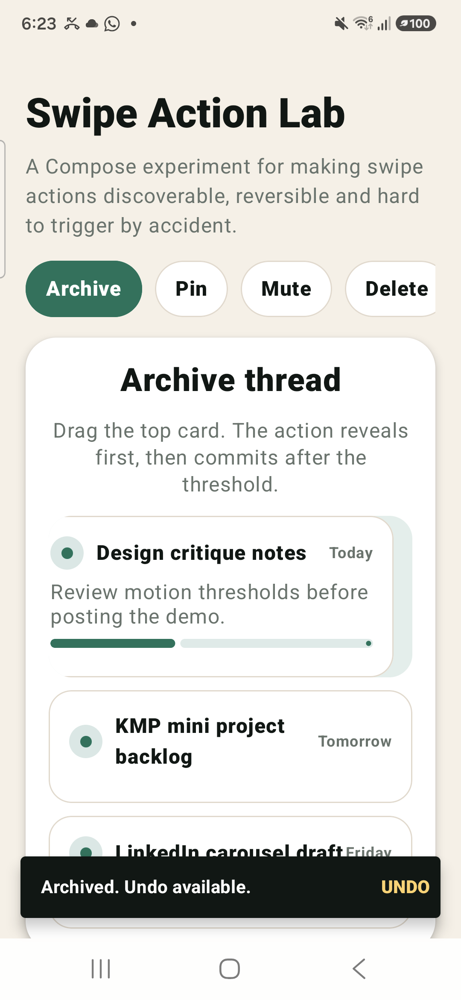

# Swipe Action Lab

Mini-projet Android/KMP pour explorer les actions par swipe dans une UI Compose.

Le but n'est pas de livrer une app complete, mais de montrer comment designer une action gestuelle lisible :

- affordance visuelle ;
- seuil de declenchement ;
- action primaire vs secondaire ;
- action destructive ;
- feedback avec undo.

## Pourquoi ce mini-projet ?

Un swipe n'est pas juste un raccourci. C'est une promesse d'efficacite qui peut vite devenir ambigue :

- l'action est-elle decouvrable ?
- le seuil evite-t-il les gestes accidentels ?
- faut-il confirmer ou proposer un undo ?
- la direction du swipe correspond-elle au modele mental ?

Chaque carte est interactive pour comparer la revelation progressive, le snap et le feedback apres action.

## Stack

- Kotlin Multiplatform
- Compose Multiplatform
- Material 3
- Android target pret a lancer

## Screenshots

<p align="center">
  
</p>

## Idee de post LinkedIn

> Un swipe bien designe donne de la vitesse. Un swipe flou ajoute de l'anxiete.
>
> Dans ce mini-projet Compose/KMP, j'explore les seuils, les actions revelees et le feedback undo.
>
> La question interessante : a quel moment un geste devient-il assez clair pour remplacer un bouton visible ?

## Run

```bash
./gradlew :composeApp:assembleDebug
```
